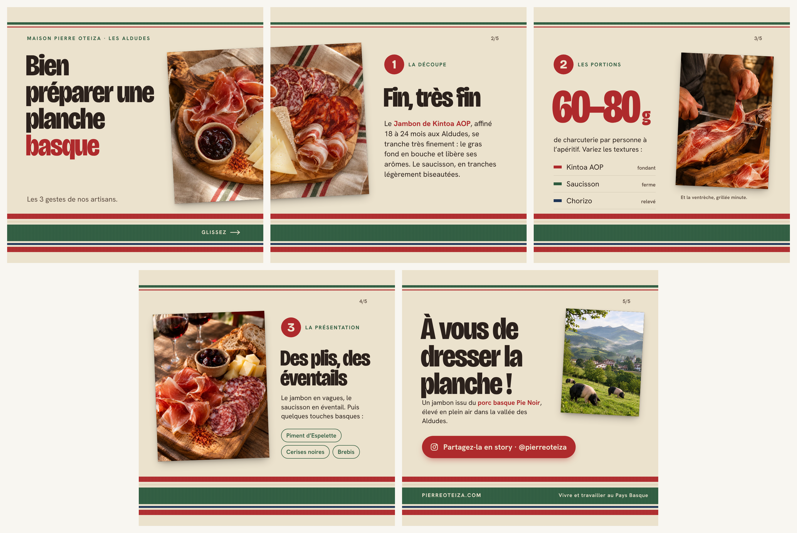
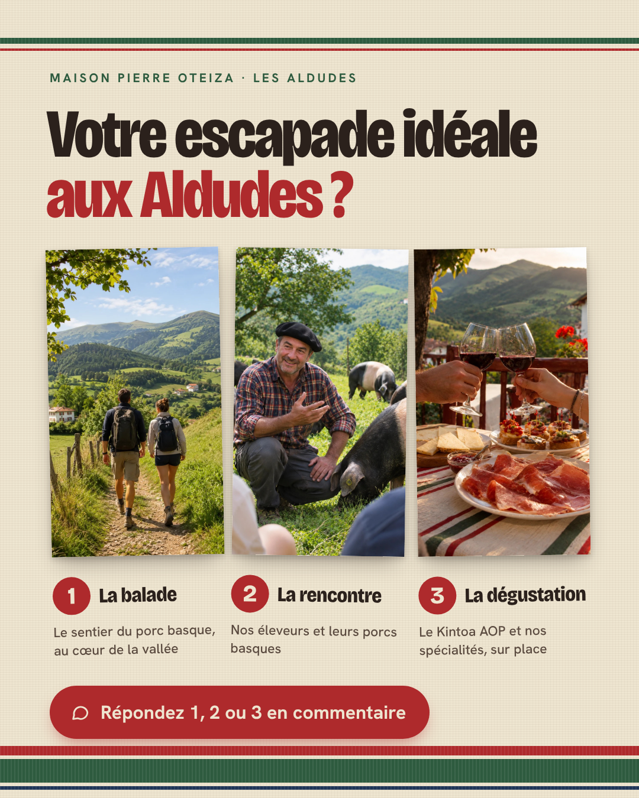

## Contenus prototypes

Parmi les publications du calendrier, nous avons réalisé deux contenus prototypes : un pour chaque plateforme retenue. Ils apparaissent en rouge (« Prototype ») dans le calendrier d'avril.

Les deux prototypes partagent la même identité visuelle, inspirée du **linge basque**, un objet du quotidien que tout le monde associe au Pays Basque. On retrouve :

- un fond écru avec une trame tissée ;
- des bandes rouge garance, vert et bleu nuit ;
- des titres très gras (Bricolage Grotesque) et un texte simple et lisible (Hanken Grotesk) ;
- des photos posées légèrement inclinées, comme des tirages sur une table.

La Maison est ainsi reconnaissable d'un réseau à l'autre, avec une image moderne mais fidèle à son territoire.

### Prototype 1 — Instagram : carrousel « Bien préparer une planche basque » (mardi 6 avril)

{width=16cm}

**Pilier :** Informer · thème Recette\
**Format :** carrousel de 5 slides carrées (1080×1080)\
**Cible :** jeunes actifs urbains de 25 à 40 ans, amateurs de gastronomie

**Pourquoi cette publication ?** Elle informe sans vendre (règle 80/20) en transmettant un savoir-faire concret. Le carrousel « tuto » est un format très enregistré et partagé, ce qui modernise l'image de la Maison. L'origine des produits (Jambon de Kintoa AOP affiné 18 à 24 mois, porc basque Pie Noir élevé en plein air aux Aldudes) est racontée au fil des gestes. Elle prépare la publication « Engager » de mai, où les abonnés partagent leur propre planche.

**Le concept :** les 5 slides forment un seul torchon basque. Les bandes se suivent sans interruption d'une slide à l'autre, et la photo de la planche est posée à cheval sur les slides 1 et 2 : on a envie de faire glisser pour dérouler le linge.

| Slide | Contenu |
|---|---|
| 1 | Titre « Bien préparer une planche basque », photo de la planche, « Glissez → » |
| 2 | ① La découpe : le Kintoa AOP se tranche très finement, presque transparent |
| 3 | ② Les portions : 60 à 80 g par personne, et 3 textures à varier |
| 4 | ③ La présentation : plis, éventails et touches basques (piment d'Espelette, cerises noires, brebis) |
| 5 | CTA : « À vous de dresser la planche ! », « Partagez-la en story · @pierreoteiza » |

**Légende proposée :** « Une belle planche, ça se prépare 🔪 Découpe, portions, présentation : les 3 gestes de nos artisans pour un apéro réussi. Enregistrez ce post pour votre prochain apéro, et montrez-nous votre planche en story en identifiant @pierreoteiza ✨ #PierreOteiza #PaysBasque #Aldudes #Kintoa #ApéroBasque »

### Prototype 2 — Facebook : post photo « Votre escapade idéale aux Aldudes » (jeudi 22 avril)

{width=9cm}

**Pilier :** Engager · thème Lifestyle\
**Format :** post photo en portrait 4:5 (1080×1350), le format qui occupe le plus de place dans le fil Facebook sur mobile\
**Cible :** habitants de la région (cible principale des 35-65 ans) et touristes qui préparent leur séjour

**Pourquoi cette publication ?** Elle fait participer la communauté avec un choix simple (1, 2 ou 3) en commentaire, ce qui augmente la portée du post sur Facebook. Elle met en avant l'expérience touristique proposée aux Aldudes : le sentier pédagogique consacré au porc basque, la rencontre avec les producteurs et la dégustation sur place. Elle est publiée en avril, au début de la saison touristique, première période prioritaire du brief.

Les trois photos ont la même taille pour ne favoriser aucune option : ① la balade, ② la rencontre avec un éleveur et ses porcs basques, ③ la dégustation en terrasse.

**Texte proposé :** « Le printemps arrive dans la vallée des Aldudes 🌿 Et vous, votre escapade idéale, ce serait plutôt… 1️⃣ la balade sur le sentier du porc basque, 2️⃣ la rencontre avec nos producteurs, 3️⃣ la dégustation de nos spécialités ? Dites-nous tout en commentaire 👇 »

### Règles de composition appliquées

| Règle | Application dans les deux prototypes |
|---|---|
| **Hiérarchie visuelle** | Un titre très gros, puis l'image, puis un texte court. Une seule idée par slide ou par bloc. |
| **Cohérence des couleurs** | Uniquement les couleurs du linge basque : écru, rouge garance, vert et bleu nuit. Le rouge est réservé aux éléments importants (chiffres, mots-clés, CTA). |
| **Lisibilité** | Texte foncé sur fond clair, avec un fort contraste. Taille de texte pensée pour une lecture sur téléphone. |
| **CTA visible** | Un bouton rouge plein avec une icône : « Partagez-la en story » sur Instagram, « Répondez 1, 2 ou 3 en commentaire » sur Facebook. |
| **Identité de marque** | Linge basque, signature « Maison Pierre Oteiza · Les Aldudes » et slogan « Vivre et travailler au Pays Basque ». |

*Les photos utilisées ont été générées par intelligence artificielle (ChatGPT) pour les besoins du prototype. Pour une publication réelle, elles seraient remplacées par des photos de la Maison.*
